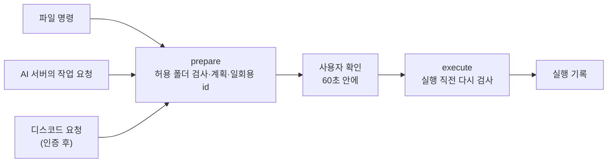

# AI 비서

캐릭터와 글·음성으로 대화하고, 내 컴퓨터의 파일까지 안전하게 다루는 개인 AI 비서 데스크톱 앱입니다.
호출어로 캐릭터를 부를 수 있고, 밖에서는 디스코드로 이 컴퓨터의 파일을 찾고 받아 볼 수 있습니다.

Electron · React · TypeScript로 만들었으며 macOS와 Windows를 대상으로 합니다.

## 주요 기능

### 캐릭터
- 그림 한 장(png, jpg, webp, gif, svg) 또는 Live2D 모델로 캐릭터를 추가합니다.
- 캐릭터마다 성격, 연결할 AI, 목소리, 호출어, 대화 기록을 따로 가집니다.
- 바탕화면에 캐릭터만 띄워 두는 마스코트 창에서 바로 말을 걸고 말풍선으로 답을 받습니다.

### AI 연결
- ChatGPT, Claude, Gemini는 API 키만 넣으면 연결됩니다.
- Ollama, LM Studio, Open WebUI 같은 로컬·호환 서버는 주소를 넣으면 종류를 자동으로 알아냅니다.
- 앱의 API 규약을 따르는 자체 비서 서버에 연결하면 자연어 파일 작업과 서버 작업 확인도 쓸 수 있습니다.

### 음성
- **음성 대화:** 주변 소음을 기준으로 말이 멈춘 것을 알아채 자동으로 보내고, 답을 읽은 뒤 이어서 듣습니다.
- **호출어:** 캐릭터 이름을 부르면 그 캐릭터로 바뀌어 듣기 시작합니다. 대기 중 소리는 저장하거나 전송하지 않습니다.
- **음성 인식:** 내 서버 → 클라우드 → 앱 안 Whisper 순서로 시도합니다. 클라우드는 기본으로 꺼져 있습니다.
- **답 읽기(TTS):** 컴퓨터 내장 음성이나 OpenAI 호환 TTS 서버를 캐릭터별로 고릅니다.

### 파일 관리
- `파일 찾기`, `열기`, `이동`, `복사`, `이름`, `폴더`, `생성`, `목록`, `백업`, `삭제` 명령을 AI 없이 앱이 직접 처리합니다.
- 사용자가 허용한 폴더 안에서만 동작합니다.
- 삭제는 실제로 지우지 않고 `_to_delete/날짜/` 폴더로 옮기며, 같은 이름이 있어도 덮어쓰지 않습니다.

### 디스코드 원격 제어
- 내 계정이 보낸 메시지만 받고, 인증 앱의 6자리 코드로 잠금을 풀어야 파일을 다룰 수 있습니다.
- 원격 허용으로 표시한 폴더만 다루며, 요청과 결과는 앱의 캐릭터별 대화 기록에 이어집니다.

## 안전 설계

음성 오인식이나 AI의 잘못된 응답이 파일 사고로 이어지지 않도록, 파일 작업은 AI와 화면에서 분리해 메인 프로세스가 맡습니다.



| 위험 | 막는 방법 |
|---|---|
| 허용 폴더 밖 접근 | 경로를 실제 위치로 바꾼 뒤 검사해 `..`와 심볼릭 링크 탈출을 거부 |
| 너무 넓은 허용 폴더 | 디스크 전체, 홈 폴더 전체, 시스템 폴더는 지정할 수 없음 |
| 비밀 파일 | `.ssh`, `.aws`, `.git` 등은 허용 폴더 안에 있어도 다루지 않음 |
| 확인 도중 파일 바꿔치기 | 크기·수정 시각·inode를 저장해 두고 실행 직전에 비교 |
| 실행 파일 열기 | `.app`, `.exe`, `.sh` 등과 실행 권한이 있는 파일은 열기 거부 |
| 서버의 이상한 요청 | 정해진 동작과 인자만 받고 나머지는 버림 |
| 내 경로가 서버로 유출 | 결과 보고에는 허용 폴더 이름 기준의 경로만 보냄 |
| 원격 계정 탈취 | 요청이 비정상적으로 많거나 코드가 반복해서 틀리면 원격을 중지 |

이동·복사·이름 변경·백업은 한 번, 삭제는 두 번 확인합니다. 저장된 API 키와 토큰은 macOS 키체인 또는 Windows DPAPI로 암호화합니다.

## 구조

화면과 메인 프로세스는 preload 하나로만 연결되고, 오가는 데이터의 모양은 `src/shared/types.ts` 한 곳에서 관리합니다.

```
src/
  main/       메인 프로세스: 서버 통신, 파일 작업, 설정 저장, 창 관리
    api/        ChatGPT · Claude · Gemini · Ollama · 비서 서버 통신
    tools/      파일 작업: policy(규칙), executor(실행), broker(확인), audit(기록)
    remote/     디스코드 연결, 인증·잠금, 비서 서버 연결
  preload/    화면에 열어 주는 기능 목록 (window.app)
  renderer/   화면(React): 대화 창, 설정, 마스코트
  shared/     세 곳이 같이 쓰는 타입과 순수 함수
test/         단위 시험과 Electron 화면 시험
tools/        가짜 서버, 빌드 보조 도구
characters/   기본 캐릭터와 Live2D 견본
```

- **판단은 코드가 합니다.** AI는 의도만 전달하고, 검사·확인·실행은 앱이 맡습니다.
- **화면은 네트워크와 파일에 직접 접근하지 않습니다.** `sandbox`와 `contextIsolation`을 켜고 정해진 IPC로만 요청합니다.
- **대화 흐름은 React 밖에 둡니다.** 대화·음성·확인 순서는 `ChatController` 클래스가 맡고, 컴포넌트는 상태를 그리기만 합니다.

## 기술 스택

| 분야 | 사용 기술 |
|---|---|
| 앱 | Electron 43, electron-vite, electron-builder |
| 화면 | React 19, TypeScript 5.9, Vite 7 |
| 캐릭터 | PixiJS 6, pixi-live2d-display |
| 음성 | transformers.js, onnxruntime-node (앱 안 Whisper), Web Audio |
| 원격 | discord.js, TOTP 직접 구현 |
| 시험 | Vitest |

## 실행

Node.js 22 이상이 필요합니다.

```bash
npm install
npm run dev
```

AI 서버 없이 둘러보려면 가짜 서버를 함께 켭니다.

```bash
npm run mock
```

1. 앱의 설정 > AI > ＋ 추가에서 서버 종류 `내 서버`, 주소 `http://127.0.0.1:8765`, 키 `dev-token`을 넣습니다.
2. 설정 > 캐릭터 > 프로필 > AI에서 그 프로필을 고르고 저장합니다.

| 명령 | 하는 일 |
|---|---|
| `npm run dev` | 개발 모드 실행 |
| `npm run build` | `out/`에 빌드 |
| `npm run typecheck` | 타입 검사 |
| `npm test` | 단위 시험 478개 |
| `npm run mock` | 가짜 비서 서버 실행 |
| `npm run dist:mac` / `npm run dist:win` | 설치 파일 만들기 (각 OS에서) |

Electron 화면 시험은 `node test/settings-window.electron.cjs`처럼 파일별로 실행하며, 임시 프로필과 가짜 서버만 사용합니다.

## 디스코드 연결

앱을 디스코드 봇에 직접 연결하는 방법입니다. 컴퓨터마다 봇을 하나씩 만듭니다.

1. [Discord Developer Portal](https://discord.com/developers/applications)에서 애플리케이션을 만들고, Bot 메뉴에서 토큰을 복사합니다. 토큰은 비밀번호처럼 다룹니다.
2. OAuth2 > URL Generator에서 `bot`을 체크해 나온 주소로 내 서버에 봇을 추가하고, 봇과 DM을 엽니다. Privileged Gateway Intents는 켜지 않아도 됩니다.
3. 디스코드 설정 > 고급에서 개발자 모드를 켜고, 내 프로필의 사용자 ID를 복사합니다.
4. 앱의 설정 > 원격 > 앱 직접 연결에 토큰과 사용자 ID를 넣고 연결합니다.
5. 설정 > 원격 > 인증·잠금에서 인증 키를 만들고 QR을 인증 앱(Google·Microsoft Authenticator 등)에 등록합니다. 복구 코드는 따로 적어 둡니다.
6. 설정 > 파일 제어에서 원격으로 다룰 폴더에 `원격 허용`을 체크합니다.
7. 봇 DM에 `인증 <6자리 코드>`를 보내면 사용할 수 있습니다.

| 보내는 말 | 하는 일 |
|---|---|
| `파일 찾기 보고서` | 원격 허용 폴더에서 이름으로 찾기 |
| `파일 보내기 보고서.pdf` | 파일을 DM으로 받기 |
| `파일 이동 …` / `파일 복사 …` | 한 번 확인 후 실행 |
| `파일 삭제 보고서.pdf` | 두 번 확인 후 `_to_delete/`로 이동 |
| `잠금` / `상태` / `도움말` | 지금 잠그기, 상태 보기, 명령 목록 |
| `원격 중지` | 모든 원격 요청 거부 |

## Live2D 캐릭터

Live2D Cubism Core는 라이선스 때문에 저장소에 포함하지 않습니다. 직접 받아 넣는 방법은 [vendor/README.md](vendor/README.md), 캐릭터를 추가하는 방법은 [characters/_live2d-template/README.md](characters/_live2d-template/README.md)에 있습니다.

## 라이선스

[MIT](LICENSE). 함께 쓰는 외부 자료의 고지는 [vendor/file-name-licenses.txt](vendor/file-name-licenses.txt)에 있습니다. Live2D Cubism Core는 별도 라이선스를 따릅니다.
